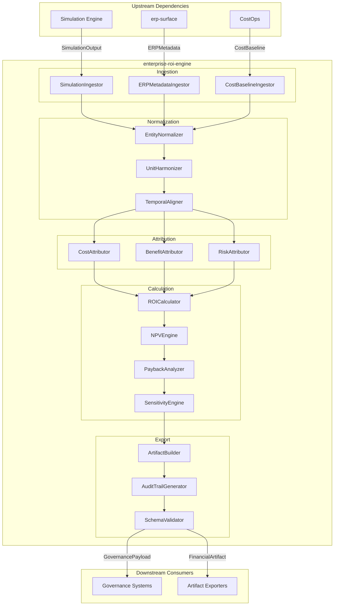

# Enterprise ROI Engine - SPARC Specification

> **Repository**: `enterprise-roi-engine`
> **Purpose**: Convert enterprise decision simulations into CFO-grade financial outcomes
> **Classification**: Valuation-critical infrastructure
> **Audience**: Senior platform engineers, finance-adjacent architects, acquisition diligence reviewers

---

## Executive Summary

The Enterprise ROI Engine translates enterprise decision simulations into defensible financial outcomes. It serves as the valuation layer between agentic simulation systems and CFO-grade financial artifacts.

**Buyer Summary**: *"They normalize enterprise systems through an ERP surface, simulate decisions safely through the Agentics simulator, and quantify real dollar impact before execution."*

This system is:
- **Cross-ERP**: Operates on normalized metadata; agnostic to source system
- **Cross-workflow**: Values decisions across procurement, HR, operations, finance
- **Cross-industry**: Applies domain-neutral valuation logic with pluggable industry parameters

This system is NOT:
- Another ERP surface
- A simulator
- An execution engine

---

# Specification

## 1. Purpose

The Enterprise ROI Engine exists to translate enterprise decision simulations into defensible financial outcomes. It serves as the valuation layer between agentic simulation systems and CFO-grade financial artifacts.

Organizations evaluating operational changes, workflow modifications, or cross-system decisions require quantifiable financial projections that can withstand executive scrutiny and due diligence review. The ROI Engine provides this translation: consuming simulation outputs, cost models, and risk parameters to produce statements of the form "this decision would save $X per year" with auditable derivation chains.

The system is valuation-critical infrastructure. It does not simulate, execute, or optimize. It values.

## 2. Scope

The Enterprise ROI Engine operates within these boundaries:

**Inputs consumed:**
- Simulation outputs from the Agentics simulation engine (decision trees, outcome probabilities, resource deltas)
- ERP metadata from erp-surface (cost centers, account hierarchies, fiscal calendars)
- Cost models (labor rates, operational costs, capital expenditure schedules)
- Risk weights and confidence parameters

**Outputs produced:**
- Savings projections with confidence intervals
- Risk-adjusted financial deltas
- Multi-year cash flow impacts
- Comparative scenario valuations
- Audit trails linking projections to source assumptions

**Operational characteristics:**
- Cross-ERP: Operates on normalized metadata; agnostic to source system
- Cross-workflow: Values decisions across procurement, HR, operations, finance
- Cross-industry: Applies domain-neutral valuation logic with pluggable industry parameters
- Read-only: Consumes data; does not write back to source systems

## 3. Non-Goals and Exclusions

The following are explicitly out of scope. The ROI Engine must NOT:

**ERP-Specific Implementations:**
- Implement SAP-specific simulators or cost engines
- Implement Oracle-specific cost engines or extractors
- Implement Workday, NetSuite, or other ERP-specific logic
- Contain ERP connection strings, credentials, or API bindings

**Execution and Orchestration:**
- Perform live execution of decisions
- Trigger ERP transactions or workflow actions
- Enforce policies or access controls
- Manage approval chains or routing

**Simulation:**
- Run decision simulations (this is the Agentics engine's responsibility)
- Generate outcome scenarios
- Model process variations or what-if trees

**Optimization:**
- Recommend optimal decisions
- Perform constraint satisfaction or linear programming
- Suggest resource allocations or scheduling

**Ancillary Services:**
- ERP savings services
- ERP integration middleware
- Data extraction or ETL pipelines
- Real-time dashboards or visualization layers

The system receives already-computed simulation results and already-extracted ERP metadata. It applies valuation logic only.

## 4. Assumptions

The following prerequisites must be satisfied for the ROI Engine to function correctly:

**Upstream Dependencies:**
- The Agentics simulation engine produces well-formed simulation output conforming to the shared schema contract
- The erp-surface service provides normalized ERP metadata (cost centers, GL mappings, fiscal periods)
- Cost models are maintained and versioned externally; the ROI Engine consumes them as configuration

**Data Quality:**
- Simulation outputs include probability distributions or point estimates with stated confidence levels
- ERP metadata reflects current organizational structure within acceptable staleness bounds
- Cost model parameters are denominated in consistent currency and fiscal periods

**Operational Context:**
- Callers provide scenario identifiers linking simulation runs to valuation requests
- Time horizons and discount rates are specified per valuation request or default to organizational policy
- Risk tolerance parameters are caller-supplied or drawn from configured defaults

**Security and Access:**
- Authentication and authorization are handled at the API gateway layer
- The ROI Engine operates on pre-authorized data; it does not perform access control decisions
- Audit logging integrates with the organization's observability infrastructure

## 5. Enterprise Use Cases

### 5.1 Procurement Decision Valuation

A simulation engine models the impact of switching from Vendor A to Vendor B for a commodity category. The simulation output includes projected unit cost changes, transition costs, and supply risk adjustments.

The ROI Engine consumes this output alongside:
- Current spend data from ERP metadata (purchase volumes, payment terms)
- Labor cost models for procurement team effort
- Risk weights for supply disruption scenarios

**Output:** "Switching to Vendor B projects $2.4M annual savings (90% CI: $1.8M-$3.1M) with a 14-month payback period, incorporating a 15% supply risk premium."

### 5.2 Workforce Reallocation Impact

A simulation evaluates moving 12 FTEs from manual invoice processing to exception handling, enabled by automation. The simulation provides productivity curves and error rate projections.

The ROI Engine consumes:
- Fully-loaded labor costs from HR ERP metadata
- Processing volume from AP system metadata
- Error remediation cost models

**Output:** "Reallocation projects $890K annual savings with a ramp period of 6 months. Risk-adjusted NPV over 3 years: $2.1M at an 8% discount rate."

### 5.3 Cross-Subsidiary Decision Comparison

A multinational evaluates implementing a shared services model across three subsidiaries. Simulations exist for each subsidiary with varying adoption timelines.

The ROI Engine produces:
- Per-subsidiary valuations in local currency
- Consolidated valuation in reporting currency with FX assumptions stated
- Sensitivity analysis on adoption timeline variance

**Output:** Comparative table showing NPV, IRR, and payback by subsidiary, with consolidated figures and explicit assumption documentation for diligence reviewers.

### 5.4 Capital Expenditure Justification

A simulation models equipment replacement options: repair, replace with equivalent, or upgrade. Each option carries different useful life and maintenance cost trajectories.

The ROI Engine values each option against:
- Capital expenditure schedules
- Depreciation policy from ERP metadata
- Maintenance cost models with inflation assumptions

**Output:** "Upgrade option shows highest 5-year NPV ($1.2M vs $840K for replace, $620K for repair) but requires $400K additional year-1 capital. Crossover point at year 3.2."

### 5.5 Risk-Adjusted Scenario Selection

Multiple simulation branches exist for a process change. Each branch carries different probability weights and outcome distributions.

The ROI Engine applies:
- Organizational risk tolerance parameters
- Probability-weighted expected values
- Downside risk metrics (VaR, CVaR equivalents for operational decisions)

**Output:** "Scenario B offers highest expected value ($3.2M) but Scenario A provides superior risk-adjusted return (Sharpe-equivalent: 1.4 vs 0.9) given stated risk tolerance."

---

# Pseudocode

This section provides implementation-ready pseudocode for the Enterprise ROI Engine. The algorithms are deterministic and language-agnostic, designed to transform simulation outputs into CFO-grade financial artifacts.

## 1. Data Ingestion Pipeline

The ingestion pipeline receives data from three upstream systems and validates structural integrity before processing.

### 1.1 Ingestion Orchestrator

```
FUNCTION ingest_all_sources(config: IngestionConfig) -> IngestionResult:
    """
    Orchestrates parallel ingestion from all upstream sources.
    Returns unified ingestion result with validation status.
    """

    results = PARALLEL_EXECUTE:
        simulation_data = ingest_simulation_outputs(config.agentics_endpoint)
        erp_metadata = ingest_erp_metadata(config.erp_surface_endpoint)
        cost_models = ingest_cost_models(config.costops_endpoint)

    IF any result in [simulation_data, erp_metadata, cost_models] has errors:
        RETURN IngestionResult(
            status = FAILED,
            errors = collect_all_errors(results),
            timestamp = current_utc_timestamp()
        )

    RETURN IngestionResult(
        status = SUCCESS,
        simulation_data = simulation_data,
        erp_metadata = erp_metadata,
        cost_models = cost_models,
        ingestion_id = generate_uuid(),
        timestamp = current_utc_timestamp()
    )
```

### 1.2 Simulation Output Ingestion

```
FUNCTION ingest_simulation_outputs(endpoint: Endpoint) -> SimulationData:
    """
    Retrieves simulation outputs from Agentics simulation engine.
    Validates schema conformance and temporal consistency.
    """

    raw_payload = http_get(endpoint, timeout = 30_seconds)

    IF raw_payload.status != 200:
        RAISE IngestionError("Agentics unavailable", raw_payload.status)

    parsed = parse_json(raw_payload.body)

    # Validate required fields
    required_fields = [
        "simulation_id",
        "run_timestamp",
        "decisions",
        "outcome_vectors",
        "confidence_intervals"
    ]

    FOR field IN required_fields:
        IF field NOT IN parsed:
            RAISE SchemaValidationError("Missing required field", field)

    # Validate temporal bounds
    IF parsed.run_timestamp > current_utc_timestamp():
        RAISE TemporalValidationError("Future timestamp rejected")

    IF parsed.run_timestamp < current_utc_timestamp() - 24_hours:
        LOG_WARNING("Stale simulation data", parsed.simulation_id)

    # Validate decision array integrity
    FOR decision IN parsed.decisions:
        validate_decision_schema(decision)
        validate_outcome_vector_alignment(decision, parsed.outcome_vectors)

    RETURN SimulationData(
        simulation_id = parsed.simulation_id,
        run_timestamp = parsed.run_timestamp,
        decisions = parsed.decisions,
        outcome_vectors = parsed.outcome_vectors,
        confidence_intervals = parsed.confidence_intervals,
        raw_checksum = compute_sha256(raw_payload.body)
    )


FUNCTION validate_decision_schema(decision: Decision) -> void:
    """Validates individual decision record structure."""

    ASSERT decision.decision_id IS NOT NULL
    ASSERT decision.decision_type IN VALID_DECISION_TYPES
    ASSERT decision.affected_entities IS NOT EMPTY
    ASSERT decision.projected_impact IS NUMERIC
    ASSERT decision.simulation_confidence IN RANGE(0.0, 1.0)
```

### 1.3 ERP Metadata Ingestion

```
FUNCTION ingest_erp_metadata(endpoint: Endpoint) -> ERPMetadata:
    """
    Retrieves organizational structure and cost center mappings from erp-surface.
    """

    raw_payload = http_get(endpoint, timeout = 45_seconds)
    parsed = parse_json(raw_payload.body)

    # Build cost center hierarchy
    cost_center_tree = build_hierarchy_tree(
        nodes = parsed.cost_centers,
        parent_key = "parent_cost_center_id",
        id_key = "cost_center_id"
    )

    # Build GL account mapping
    gl_account_map = {}
    FOR account IN parsed.gl_accounts:
        gl_account_map[account.account_id] = GLAccount(
            account_id = account.account_id,
            account_name = account.name,
            account_type = classify_account_type(account.account_number),
            currency = account.currency,
            is_active = account.status == "ACTIVE"
        )

    # Build entity-to-cost-center mapping
    entity_mapping = {}
    FOR mapping IN parsed.entity_mappings:
        entity_mapping[mapping.entity_id] = CostCenterAssignment(
            cost_center_id = mapping.cost_center_id,
            allocation_percentage = mapping.allocation_pct,
            effective_date = mapping.effective_from,
            expiry_date = mapping.effective_to
        )

    RETURN ERPMetadata(
        cost_center_tree = cost_center_tree,
        gl_account_map = gl_account_map,
        entity_mapping = entity_mapping,
        fiscal_calendar = parse_fiscal_calendar(parsed.fiscal_periods),
        base_currency = parsed.reporting_currency,
        snapshot_timestamp = parsed.snapshot_timestamp
    )
```

### 1.4 Cost Model Ingestion

```
FUNCTION ingest_cost_models(endpoint: Endpoint) -> CostModels:
    """
    Retrieves baseline cost models and risk weights from CostOps.
    These serve as reference baselines for delta calculations.
    """

    raw_payload = http_get(endpoint, timeout = 30_seconds)
    parsed = parse_json(raw_payload.body)

    # Parse unit cost schedules
    unit_costs = {}
    FOR schedule IN parsed.cost_schedules:
        unit_costs[schedule.resource_type] = UnitCostSchedule(
            resource_type = schedule.resource_type,
            base_unit_cost = schedule.base_cost,
            volume_tiers = parse_volume_tiers(schedule.tiers),
            currency = schedule.currency,
            effective_date = schedule.effective_from
        )

    # Parse risk weight matrices
    risk_weights = {}
    FOR category IN parsed.risk_categories:
        risk_weights[category.category_id] = RiskWeightMatrix(
            category_id = category.category_id,
            base_weight = category.base_weight,
            volatility_multiplier = category.volatility_mult,
            confidence_decay_rate = category.confidence_decay,
            max_weight = category.ceiling
        )

    # Parse overhead allocation rates
    overhead_rates = {}
    FOR rate IN parsed.overhead_allocations:
        overhead_rates[rate.cost_center_id] = OverheadRate(
            direct_rate = rate.direct_pct,
            indirect_rate = rate.indirect_pct,
            shared_services_rate = rate.shared_services_pct
        )

    RETURN CostModels(
        unit_costs = unit_costs,
        risk_weights = risk_weights,
        overhead_rates = overhead_rates,
        model_version = parsed.version,
        baseline_period = parsed.baseline_period
    )
```

## 2. Normalization Layer

The normalization layer converts heterogeneous input formats into a canonical internal representation, ensuring consistent downstream processing.

### 2.1 Canonical Schema Definition

```
STRUCTURE CanonicalDecisionRecord:
    """Normalized representation of a simulation decision with financial context."""

    record_id: UUID                      # Unique identifier for this record
    source_decision_id: String           # Original decision ID from simulation
    decision_timestamp: UTCTimestamp     # When decision was simulated

    # Decision classification
    decision_category: ENUM(
        RESOURCE_ALLOCATION,
        PROCESS_OPTIMIZATION,
        VENDOR_SELECTION,
        CAPACITY_PLANNING,
        RISK_MITIGATION,
        COST_REDUCTION
    )

    # Financial attribution
    primary_cost_center_id: String
    secondary_cost_centers: List<CostCenterAllocation>
    gl_account_impacts: List<GLAccountImpact>

    # Quantified impacts (all in base currency)
    gross_impact_amount: Decimal
    confidence_score: Decimal            # 0.0 to 1.0
    impact_horizon_months: Integer

    # Risk adjustment inputs
    risk_category_id: String
    volatility_score: Decimal

    # Lineage
    source_system: String
    normalization_timestamp: UTCTimestamp


STRUCTURE CostCenterAllocation:
    cost_center_id: String
    allocation_percentage: Decimal       # Must sum to 100% across all allocations
    allocation_method: ENUM(DIRECT, STEP_DOWN, ACTIVITY_BASED)


STRUCTURE GLAccountImpact:
    gl_account_id: String
    impact_type: ENUM(DEBIT, CREDIT)
    amount: Decimal
    period: FiscalPeriod
```

### 2.2 Normalization Orchestrator

```
FUNCTION normalize_ingested_data(
    ingestion_result: IngestionResult
) -> NormalizedDataset:
    """
    Transforms all ingested data into canonical format.
    Applies currency conversion, temporal alignment, and schema mapping.
    """

    base_currency = ingestion_result.erp_metadata.base_currency

    # Step 1: Normalize simulation decisions
    normalized_decisions = []
    FOR decision IN ingestion_result.simulation_data.decisions:
        normalized = normalize_decision(
            decision = decision,
            erp_metadata = ingestion_result.erp_metadata,
            cost_models = ingestion_result.cost_models,
            target_currency = base_currency
        )
        normalized_decisions.APPEND(normalized)

    # Step 2: Validate referential integrity
    validation_errors = validate_referential_integrity(
        decisions = normalized_decisions,
        erp_metadata = ingestion_result.erp_metadata
    )

    IF validation_errors IS NOT EMPTY:
        FOR error IN validation_errors:
            IF error.severity == CRITICAL:
                RAISE IntegrityValidationError(error)
            ELSE:
                LOG_WARNING(error)
                apply_fallback_mapping(error.record, ingestion_result.erp_metadata)

    # Step 3: Deduplicate and merge
    deduplicated_decisions = deduplicate_decisions(normalized_decisions)

    RETURN NormalizedDataset(
        decisions = deduplicated_decisions,
        erp_context = ingestion_result.erp_metadata,
        cost_context = ingestion_result.cost_models,
        normalization_id = generate_uuid(),
        record_count = LENGTH(deduplicated_decisions),
        normalization_timestamp = current_utc_timestamp()
    )
```

### 2.3 Decision Normalization

```
FUNCTION normalize_decision(
    decision: RawDecision,
    erp_metadata: ERPMetadata,
    cost_models: CostModels,
    target_currency: CurrencyCode
) -> CanonicalDecisionRecord:
    """
    Transforms a raw simulation decision into canonical format.
    """

    # Resolve decision category from type mapping
    decision_category = map_decision_type_to_category(decision.decision_type)

    # Resolve primary cost center from affected entities
    primary_entity = decision.affected_entities[0]
    cost_center_assignment = erp_metadata.entity_mapping[primary_entity]

    IF cost_center_assignment IS NULL:
        cost_center_assignment = resolve_fallback_cost_center(
            entity_id = primary_entity,
            cost_center_tree = erp_metadata.cost_center_tree
        )

    # Build secondary cost center allocations
    secondary_allocations = []
    FOR entity IN decision.affected_entities[1:]:
        assignment = erp_metadata.entity_mapping[entity]
        IF assignment IS NOT NULL:
            secondary_allocations.APPEND(CostCenterAllocation(
                cost_center_id = assignment.cost_center_id,
                allocation_percentage = assignment.allocation_percentage,
                allocation_method = DIRECT
            ))

    # Normalize allocation percentages to sum to 100%
    secondary_allocations = normalize_allocation_percentages(secondary_allocations)

    # Convert monetary amount to base currency
    gross_impact = convert_currency(
        amount = decision.projected_impact,
        from_currency = decision.currency,
        to_currency = target_currency,
        rate_date = decision.effective_date
    )

    # Map to GL accounts based on decision category
    gl_impacts = map_to_gl_accounts(
        decision_category = decision_category,
        impact_amount = gross_impact,
        cost_center_id = cost_center_assignment.cost_center_id,
        gl_account_map = erp_metadata.gl_account_map
    )

    # Determine risk category
    risk_category = determine_risk_category(
        decision_category = decision_category,
        confidence = decision.simulation_confidence,
        risk_weights = cost_models.risk_weights
    )

    RETURN CanonicalDecisionRecord(
        record_id = generate_uuid(),
        source_decision_id = decision.decision_id,
        decision_timestamp = decision.timestamp,
        decision_category = decision_category,
        primary_cost_center_id = cost_center_assignment.cost_center_id,
        secondary_cost_centers = secondary_allocations,
        gl_account_impacts = gl_impacts,
        gross_impact_amount = gross_impact,
        confidence_score = decision.simulation_confidence,
        impact_horizon_months = extract_horizon_months(decision.time_horizon),
        risk_category_id = risk_category.category_id,
        volatility_score = calculate_volatility_score(decision.outcome_variance),
        source_system = "AGENTICS",
        normalization_timestamp = current_utc_timestamp()
    )
```

### 2.4 GL Account Mapping

```
FUNCTION map_to_gl_accounts(
    decision_category: DecisionCategory,
    impact_amount: Decimal,
    cost_center_id: String,
    gl_account_map: Map<String, GLAccount>
) -> List<GLAccountImpact>:
    """
    Maps decision impacts to appropriate GL accounts based on category and sign.
    Returns balanced debit/credit entries.
    """

    # Define account mapping rules
    account_rules = {
        RESOURCE_ALLOCATION: {
            positive: {debit: "5100-LABOR", credit: "2100-ACCRUED-SAVINGS"},
            negative: {debit: "5100-LABOR", credit: "1000-CASH"}
        },
        PROCESS_OPTIMIZATION: {
            positive: {debit: "5200-OPEX", credit: "2100-ACCRUED-SAVINGS"},
            negative: {debit: "5200-OPEX", credit: "1000-CASH"}
        },
        VENDOR_SELECTION: {
            positive: {debit: "5300-PROCUREMENT", credit: "2100-ACCRUED-SAVINGS"},
            negative: {debit: "5300-PROCUREMENT", credit: "2000-ACCOUNTS-PAYABLE"}
        },
        CAPACITY_PLANNING: {
            positive: {debit: "5400-CAPACITY", credit: "2100-ACCRUED-SAVINGS"},
            negative: {debit: "1500-FIXED-ASSETS", credit: "1000-CASH"}
        },
        RISK_MITIGATION: {
            positive: {debit: "5500-RISK-MGMT", credit: "2100-ACCRUED-SAVINGS"},
            negative: {debit: "5500-RISK-MGMT", credit: "2500-CONTINGENCY"}
        },
        COST_REDUCTION: {
            positive: {debit: "5000-COGS", credit: "2100-ACCRUED-SAVINGS"},
            negative: {debit: "5000-COGS", credit: "1000-CASH"}
        }
    }

    rule = account_rules[decision_category]
    impact_sign = IF impact_amount >= 0 THEN "positive" ELSE "negative"
    selected_rule = rule[impact_sign]

    absolute_amount = ABS(impact_amount)

    # Resolve actual GL account IDs
    debit_account = resolve_gl_account(
        account_pattern = selected_rule.debit,
        cost_center_id = cost_center_id,
        gl_account_map = gl_account_map
    )

    credit_account = resolve_gl_account(
        account_pattern = selected_rule.credit,
        cost_center_id = cost_center_id,
        gl_account_map = gl_account_map
    )

    RETURN [
        GLAccountImpact(
            gl_account_id = debit_account.account_id,
            impact_type = DEBIT,
            amount = absolute_amount,
            period = current_fiscal_period()
        ),
        GLAccountImpact(
            gl_account_id = credit_account.account_id,
            impact_type = CREDIT,
            amount = absolute_amount,
            period = current_fiscal_period()
        )
    ]
```

## 3. Attribution Engine

The attribution engine maps simulation outcomes to cost centers and financial line items, creating auditable trails for each attribution decision.

### 3.1 Attribution Orchestrator

```
FUNCTION execute_attribution(
    normalized_dataset: NormalizedDataset
) -> AttributionResult:
    """
    Performs multi-dimensional attribution of decision impacts.
    Creates full attribution chains for audit compliance.
    """

    attribution_records = []

    FOR decision IN normalized_dataset.decisions:
        # Step 1: Compute primary attribution
        primary_attribution = compute_primary_attribution(
            decision = decision,
            erp_context = normalized_dataset.erp_context
        )

        # Step 2: Apply overhead allocation
        overhead_attribution = apply_overhead_allocation(
            primary_attribution = primary_attribution,
            overhead_rates = normalized_dataset.cost_context.overhead_rates
        )

        # Step 3: Distribute to secondary cost centers
        distributed_attributions = distribute_to_secondaries(
            primary_attribution = overhead_attribution,
            secondary_allocations = decision.secondary_cost_centers
        )

        # Step 4: Build attribution chain
        attribution_chain = AttributionChain(
            decision_record_id = decision.record_id,
            primary_attribution = primary_attribution,
            overhead_attribution = overhead_attribution,
            distributed_attributions = distributed_attributions,
            total_attributed_amount = SUM(a.amount FOR a IN distributed_attributions),
            attribution_method = determine_attribution_method(decision),
            attribution_timestamp = current_utc_timestamp()
        )

        # Validate attribution completeness
        validate_attribution_completeness(attribution_chain, decision)

        attribution_records.APPEND(attribution_chain)

    # Aggregate by cost center for summary
    cost_center_summaries = aggregate_by_cost_center(attribution_records)

    # Aggregate by GL account for financial reporting
    gl_account_summaries = aggregate_by_gl_account(attribution_records)

    RETURN AttributionResult(
        attribution_chains = attribution_records,
        cost_center_summaries = cost_center_summaries,
        gl_account_summaries = gl_account_summaries,
        total_attributed_value = SUM(r.total_attributed_amount FOR r IN attribution_records),
        attribution_id = generate_uuid(),
        timestamp = current_utc_timestamp()
    )
```

### 3.2 Risk Adjustment

```
FUNCTION apply_risk_adjustment(
    gross_delta: GrossDelta,
    decision: CanonicalDecisionRecord,
    risk_weights: Map<String, RiskWeightMatrix>
) -> RiskAdjustedDelta:
    """
    Applies risk-based adjustments to gross delta.
    Uses confidence decay and volatility multipliers.
    """

    risk_matrix = risk_weights.get(
        decision.risk_category_id,
        DEFAULT_RISK_MATRIX
    )

    # Calculate base risk weight
    base_weight = risk_matrix.base_weight

    # Apply confidence decay
    confidence_factor = 1.0 - (
        (1.0 - decision.confidence_score) * risk_matrix.confidence_decay_rate
    )

    # Apply volatility adjustment
    volatility_adjustment = 1.0 + (
        decision.volatility_score * risk_matrix.volatility_multiplier
    )

    # Calculate composite risk factor
    risk_factor = base_weight * volatility_adjustment / confidence_factor
    risk_factor = MIN(risk_factor, risk_matrix.max_weight)

    # Apply risk adjustment to delta
    adjusted_savings = gross_delta.total_savings / risk_factor
    adjusted_costs = gross_delta.total_costs * risk_factor
    adjusted_net = adjusted_savings - adjusted_costs

    RETURN RiskAdjustedDelta(
        decision_record_id = gross_delta.decision_record_id,
        gross_net_delta = gross_delta.net_delta,
        adjusted_savings = adjusted_savings,
        adjusted_costs = adjusted_costs,
        adjusted_net_delta = adjusted_net,
        risk_factor = risk_factor,
        risk_components = {
            "base_weight": base_weight,
            "confidence_factor": confidence_factor,
            "volatility_adjustment": volatility_adjustment
        },
        risk_category = decision.risk_category_id
    )
```

## 4. Financial Delta Calculator

### 4.1 Time-Value Adjustment

```
FUNCTION apply_time_value_adjustment(
    risk_adjusted_delta: RiskAdjustedDelta,
    horizon_months: Integer,
    discount_rate: Decimal
) -> TimeAdjustedDelta:
    """
    Applies time-value-of-money adjustments for multi-period impacts.
    Uses monthly discounting for precision.
    """

    monthly_rate = discount_rate / 12.0

    IF horizon_months <= 1:
        present_value = risk_adjusted_delta.adjusted_net_delta
        discount_factor = 1.0
    ELSE:
        monthly_delta = risk_adjusted_delta.adjusted_net_delta / horizon_months

        present_value = 0
        FOR month IN RANGE(1, horizon_months + 1):
            discount_factor_m = 1.0 / POWER(1.0 + monthly_rate, month)
            present_value += monthly_delta * discount_factor_m

        discount_factor = present_value / risk_adjusted_delta.adjusted_net_delta

    RETURN TimeAdjustedDelta(
        decision_record_id = risk_adjusted_delta.decision_record_id,
        undiscounted_delta = risk_adjusted_delta.adjusted_net_delta,
        present_value = present_value,
        discount_factor = discount_factor,
        horizon_months = horizon_months,
        monthly_discount_rate = monthly_rate,
        annualized_value = present_value * (12.0 / MAX(horizon_months, 1))
    )
```

### 4.2 Confidence Interval Calculation

```
FUNCTION calculate_confidence_intervals(
    base_delta: TimeAdjustedDelta,
    confidence_score: Decimal,
    volatility_score: Decimal
) -> ConfidenceIntervals:
    """
    Generates probabilistic confidence intervals around delta estimates.
    """

    base_value = base_delta.present_value
    uncertainty_factor = (1.0 - confidence_score) * (1.0 + volatility_score)

    z_scores = {
        50: 0.674,
        75: 1.150,
        90: 1.645,
        95: 1.960,
        99: 2.576
    }

    intervals = {}
    FOR confidence_level, z_score IN z_scores:
        margin = ABS(base_value) * uncertainty_factor * z_score
        intervals[confidence_level] = ConfidenceInterval(
            confidence_level = confidence_level,
            lower_bound = base_value - margin,
            upper_bound = base_value + margin,
            margin = margin,
            z_score = z_score
        )

    p10_value = intervals[90].lower_bound
    p90_value = intervals[90].upper_bound

    RETURN ConfidenceIntervals(
        base_value = base_value,
        intervals = intervals,
        p10_value = p10_value,
        p50_value = base_value,
        p90_value = p90_value,
        uncertainty_factor = uncertainty_factor
    )
```

## 5. Main Execution Pipeline

```
FUNCTION execute_roi_engine(config: EngineConfig) -> ExecutionResult:
    """
    Main entry point for the Enterprise ROI Engine.
    Orchestrates the complete pipeline from ingestion to artifact generation.
    """

    execution_id = generate_uuid()
    start_time = current_utc_timestamp()

    TRY:
        # Phase 1: Ingestion
        ingestion_result = ingest_all_sources(config.ingestion_config)
        validate_ingestion_result(ingestion_result)

        # Phase 2: Normalization
        normalized_dataset = normalize_ingested_data(ingestion_result)

        # Phase 3: Attribution
        attribution_result = execute_attribution(normalized_dataset)

        # Phase 4: Delta Calculation
        delta_result = calculate_financial_deltas(
            attribution_result = attribution_result,
            cost_models = ingestion_result.cost_models,
            simulation_data = ingestion_result.simulation_data
        )

        # Phase 5: Artifact Generation
        artifact_bundle = generate_financial_artifacts(
            delta_result = delta_result,
            attribution_result = attribution_result,
            normalized_dataset = normalized_dataset,
            config = config.artifact_config
        )

        RETURN ExecutionResult(
            execution_id = execution_id,
            status = SUCCESS,
            artifact_bundle = artifact_bundle,
            metrics = ExecutionMetrics(
                decisions_processed = LENGTH(normalized_dataset.decisions),
                total_savings_identified = delta_result.portfolio_metrics.total_present_value,
                execution_duration_ms = end_time - start_time,
                phases_completed = 5
            )
        )

    CATCH error:
        RETURN ExecutionResult(
            execution_id = execution_id,
            status = FAILED,
            error = error
        )
```

---

# Architecture

## Overview

The enterprise-roi-engine is a stateless computation engine that transforms simulation outputs into auditable financial projections. It operates as a pure function: given identical inputs from the simulation engine, erp-surface, and CostOps baseline, it produces identical financial artifacts suitable for CFO-level review.

```
┌─────────────────────────────────────────────────────────────────────────────┐
│                           UPSTREAM DEPENDENCIES                              │
├───────────────────┬───────────────────────┬─────────────────────────────────┤
│  Simulation       │     erp-surface       │         CostOps                 │
│  Engine           │                       │     (baseline only)             │
│  ───────────      │     ───────────       │     ───────────────             │
│  Decision trees   │     ERP metadata      │     Cost model                  │
│  Workflow traces  │     Entity mappings   │     snapshots                   │
│  Resource deltas  │     Chart of accounts │                                 │
└────────┬──────────┴───────────┬───────────┴──────────────┬──────────────────┘
         │                      │                          │
         ▼                      ▼                          ▼
┌─────────────────────────────────────────────────────────────────────────────┐
│                        ENTERPRISE-ROI-ENGINE                                 │
│  ┌─────────────────────────────────────────────────────────────────────┐    │
│  │                         INGESTION LAYER                              │    │
│  │   SimulationIngestor │ ERPMetadataIngestor │ CostBaselineIngestor   │    │
│  └─────────────────────────────────────────────────────────────────────┘    │
│                                    │                                         │
│                                    ▼                                         │
│  ┌─────────────────────────────────────────────────────────────────────┐    │
│  │                       NORMALIZATION LAYER                            │    │
│  │         EntityNormalizer │ UnitHarmonizer │ TemporalAligner         │    │
│  └─────────────────────────────────────────────────────────────────────┘    │
│                                    │                                         │
│                                    ▼                                         │
│  ┌─────────────────────────────────────────────────────────────────────┐    │
│  │                        ATTRIBUTION LAYER                             │    │
│  │       CostAttributor │ BenefitAttributor │ RiskAttributor           │    │
│  └─────────────────────────────────────────────────────────────────────┘    │
│                                    │                                         │
│                                    ▼                                         │
│  ┌─────────────────────────────────────────────────────────────────────┐    │
│  │                        CALCULATION LAYER                             │    │
│  │    ROICalculator │ NPVEngine │ PaybackAnalyzer │ SensitivityEngine  │    │
│  └─────────────────────────────────────────────────────────────────────┘    │
│                                    │                                         │
│                                    ▼                                         │
│  ┌─────────────────────────────────────────────────────────────────────┐    │
│  │                          EXPORT LAYER                                │    │
│  │      ArtifactBuilder │ AuditTrailGenerator │ SchemaValidator        │    │
│  └─────────────────────────────────────────────────────────────────────┘    │
└─────────────────────────────────────────────────────────────────────────────┘
                                     │
                                     ▼
┌─────────────────────────────────────────────────────────────────────────────┐
│                         DOWNSTREAM CONSUMERS                                 │
├─────────────────────────────────┬───────────────────────────────────────────┤
│       Governance Systems        │           Artifact Exporters              │
│       ──────────────────        │           ─────────────────               │
│       Policy validation         │           PDF/Excel generation            │
│       Approval workflows        │           Data warehouse loads            │
│       Compliance checks         │           API consumers                   │
└─────────────────────────────────┴───────────────────────────────────────────┘
```

## 1. Internal Components

### 1.1 Ingestion Layer

| Component | Responsibility | Failure Mode |
|-----------|---------------|--------------|
| `SimulationIngestor` | Validates and deserializes simulation output payloads | Hard fail with schema violation report |
| `ERPMetadataIngestor` | Consumes ERP entity mappings and chart-of-accounts structures | Hard fail if entity resolution impossible |
| `CostBaselineIngestor` | Loads point-in-time cost model snapshots from CostOps | Hard fail if baseline missing or corrupt |

### 1.2 Normalization Layer

| Component | Responsibility | Design Rationale |
|-----------|---------------|------------------|
| `EntityNormalizer` | Maps heterogeneous ERP entity identifiers to canonical internal IDs | Enables cross-ERP comparisons without ERP-specific logic |
| `UnitHarmonizer` | Converts currencies, time units, and quantity measures to standard units | Eliminates unit ambiguity |
| `TemporalAligner` | Aligns simulation time horizons with fiscal calendars | CFO artifacts require fiscal period alignment |

### 1.3 Attribution Layer

| Component | Responsibility | Boundary |
|-----------|---------------|----------|
| `CostAttributor` | Allocates simulation-derived costs to cost centers and GL accounts | Computes attribution; does not validate against ERP actuals |
| `BenefitAttributor` | Maps projected efficiency gains to monetary values | Uses input benefit coefficients; does not derive coefficients |
| `RiskAttributor` | Assigns risk weights to projections based on confidence intervals | Computes risk-adjusted values; does not perform Monte Carlo simulation |

### 1.4 Calculation Layer

| Component | Responsibility | Determinism Guarantee |
|-----------|---------------|----------------------|
| `ROICalculator` | Computes return on investment using attributed costs and benefits | Pure function; no random components |
| `NPVEngine` | Calculates net present value using configurable discount rates | Discount rates are explicit inputs |
| `PaybackAnalyzer` | Determines payback period with optional discounted payback variant | Time-series computation; no stochastic elements |
| `SensitivityEngine` | Produces sensitivity tables showing outcome variance across input ranges | Parameter ranges are explicit inputs |

### 1.5 Export Layer

| Component | Responsibility | Output Guarantee |
|-----------|---------------|-----------------|
| `ArtifactBuilder` | Assembles calculation outputs into structured artifacts | Schema-validated JSON |
| `AuditTrailGenerator` | Produces complete provenance records | Enables reproduction |
| `SchemaValidator` | Final-gate validation ensuring all outputs conform to schemas | Rejects non-conforming outputs |

## 2. Data Contracts

### 2.1 Input Schemas

#### Simulation Engine Input

```typescript
interface SimulationOutput {
  metadata: {
    simulationId: string;
    engineVersion: string;
    timestamp: ISO8601;
    checksum: string;
  };
  scenario: {
    name: string;
    baselineId: string;
    timeHorizonMonths: number;
    confidenceLevel: number;
  };
  decisions: DecisionNode[];
  resourceDeltas: ResourceDelta[];
  workflowTraces: WorkflowTrace[];
}

interface DecisionNode {
  nodeId: string;
  parentId: string | null;
  decision: string;
  probability: number;
  outcomeMetrics: Record<string, number>;
}

interface ResourceDelta {
  period: number;
  resourceType: string;
  quantity: number;
  unit: string;
  direction: 'increase' | 'decrease';
}
```

#### ERP Surface Input

```typescript
interface ERPMetadata {
  erpSystem: string;
  erpVersion: string;
  extractTimestamp: ISO8601;
  entities: EntityMapping[];
  chartOfAccounts: GLAccount[];
  costCenters: CostCenter[];
  fiscalCalendar: FiscalPeriod[];
}

interface EntityMapping {
  erpEntityId: string;
  entityType: string;
  displayName: string;
  parentId: string | null;
  attributes: Record<string, string>;
}
```

#### CostOps Baseline Input

```typescript
interface CostBaseline {
  baselineId: string;
  snapshotTimestamp: ISO8601;
  costModelVersion: string;
  laborRates: LaborRate[];
  infrastructureCosts: InfraCost[];
  licenseCosts: LicenseCost[];
  overheadFactors: OverheadFactor[];
}

interface LaborRate {
  roleId: string;
  roleName: string;
  fullyLoadedRate: number;
  currency: string;
  effectiveDate: ISO8601;
}
```

### 2.2 Output Schemas

#### Financial Artifact Output

```typescript
interface FinancialArtifact {
  artifactId: string;
  generatedAt: ISO8601;
  engineVersion: string;
  inputManifest: InputManifest;

  summary: {
    totalInvestment: MonetaryValue;
    totalBenefit: MonetaryValue;
    netBenefit: MonetaryValue;
    roi: Percentage;
    roiMethodology: string;
    paybackPeriodMonths: number;
    npv: MonetaryValue;
    discountRate: Percentage;
    confidenceInterval: ConfidenceInterval;
  };

  periodDetails: PeriodDetail[];
  attributions: Attribution[];
  sensitivityAnalysis: SensitivityTable;
  auditTrail: AuditRecord[];
}

interface InputManifest {
  simulationId: string;
  simulationChecksum: string;
  erpMetadataChecksum: string;
  costBaselineId: string;
  costBaselineChecksum: string;
  calculationParameters: Record<string, any>;
}
```

## 3. Cost and Risk Modeling Boundaries

### What the Engine Computes

| Domain | Computation | Input Source |
|--------|-------------|--------------|
| Cost attribution | Allocation of simulation-derived costs to GL accounts | ERP metadata mappings |
| Benefit quantification | Monetary valuation of efficiency gains | Benefit coefficients in simulation output |
| Time-value adjustments | NPV, discounted payback | Discount rate as calculation parameter |
| Sensitivity ranges | Outcome variance across parameter ranges | Parameter ranges as calculation input |
| Risk-adjusted values | Weighted projections using confidence intervals | Confidence levels from simulation output |

### What the Engine Delegates

| Domain | Delegated To | Rationale |
|--------|--------------|-----------|
| Cost model maintenance | CostOps | Engine consumes snapshots; does not update |
| Monte Carlo simulation | Simulation Engine | Stochastic computation belongs upstream |
| Live ERP data access | erp-surface | Engine uses metadata snapshots |
| Policy enforcement | Governance Systems | Engine produces data; does not enforce |
| Approval workflows | Governance Systems | Engine flags; does not act |
| Format rendering | Artifact Exporters | Engine produces structured data |

## 4. Determinism Guarantees

### Reproducibility Contract

Given identical inputs `(SimulationOutput, ERPMetadata, CostBaseline, CalculationParameters)`, the engine produces byte-identical `FinancialArtifact` outputs.

### Implementation Mechanisms

| Mechanism | Implementation | Verification |
|-----------|----------------|--------------|
| **Input checksums** | SHA-256 of all inputs stored in `InputManifest` | Enables input identity verification |
| **Sorted iteration** | All collection iterations use deterministic ordering | Eliminates hash-map ordering variance |
| **Fixed-precision arithmetic** | Decimal arithmetic with explicit precision (4 decimal places) | Eliminates floating-point variance |
| **Immutable rate tables** | Currency/unit conversion rates are versioned inputs | Removes external state dependency |
| **Timestamp freezing** | Calculation uses input timestamps | Generation time does not affect calculations |
| **No random components** | Zero use of random number generation | Removes stochastic variance |
| **Version binding** | Engine version recorded in output | Enables compatibility tracking |

## 5. Integration Points

### 5.1 Upstream: Simulation Engine

| Aspect | Specification |
|--------|--------------|
| **Protocol** | Structured payload (JSON) via message queue or direct invocation |
| **Trigger** | Simulation completion event |
| **Contract** | `SimulationOutput` schema with version compatibility matrix |
| **Idempotency** | `simulationId` serves as idempotency key |

### 5.2 Upstream: erp-surface

| Aspect | Specification |
|--------|--------------|
| **Protocol** | Snapshot retrieval via API or pre-staged files |
| **Data freshness** | Snapshots are point-in-time |
| **Contract** | `ERPMetadata` schema |

### 5.3 Upstream: CostOps (Baseline Input Only)

| Aspect | Specification |
|--------|--------------|
| **Protocol** | Baseline retrieval by `baselineId` |
| **Direction** | Read-only; engine never writes to CostOps |
| **Contract** | `CostBaseline` schema |

### 5.4 Downstream: Governance Systems

| Aspect | Specification |
|--------|--------------|
| **Protocol** | Push `GovernancePayload` on artifact generation |
| **Responsibility boundary** | Engine flags conditions; governance decides actions |

### 5.5 Downstream: Artifact Exporters

| Aspect | Specification |
|--------|--------------|
| **Protocol** | Pull `FinancialArtifact` by `artifactId` or push to export queue |
| **Supported targets** | PDF, Excel, data warehouse, API consumers |

## Component Interaction Diagram



## Invariants

1. **Statelessness**: The engine maintains no persistent state between invocations
2. **Input completeness**: All calculation inputs are explicit
3. **Output traceability**: Every output value traces to specific input values
4. **Schema compliance**: All inputs and outputs validate against published schemas
5. **Isolation**: No network access to external systems during calculation

---

# Refinement

## 1. Phased Delivery Roadmap

### MVP: Core Financial Delta Calculation

**Objective:** Prove the fundamental value proposition.

**Deliverables:**
- Financial delta calculation engine with hardcoded cost models for 3 reference industries
- Input adapter for Agentics simulation engine output format
- Basic ERP metadata consumption from erp-surface
- JSON output format for downstream consumption
- Unit test coverage >90% on calculation paths

**Exit Criteria:**
- [ ] Calculate financial delta for single simulation run within 500ms
- [ ] Output matches manual spreadsheet calculation within 0.01% variance
- [ ] Three reference customers validate output format

### v0.5: Dynamic Cost Model Ingestion

**Objective:** Replace hardcoded models with live CostOps integration.

**Deliverables:**
- CostOps adapter with polling and webhook support
- Cost model versioning and effective-date handling
- Cost model validation layer
- Fallback to cached models on CostOps unavailability
- Cost model audit trail

**Exit Criteria:**
- [ ] Cost model refresh latency <5s from CostOps update
- [ ] Graceful degradation tested with 24-hour CostOps outage simulation
- [ ] Audit trail queryable for any calculation in past 90 days

### v0.8: Risk Weight Integration and Confidence Intervals

**Objective:** Transform point estimates into probabilistic ranges.

**Deliverables:**
- Monte Carlo simulation engine for confidence interval generation
- Risk weight taxonomy aligned with enterprise risk frameworks
- Sensitivity analysis output
- Configurable confidence levels (P50, P75, P90, P95)

**Exit Criteria:**
- [ ] Confidence intervals validated against 6-month actuals from 3 pilot customers
- [ ] P90 estimates contain actual outcomes >85% of the time in backtesting

### v1.0: Full Artifact Export with Governance Integration

**Objective:** Production-ready system with complete audit trail.

**Deliverables:**
- PDF report generator (CFO presentation format)
- Excel export with calculation transparency
- Governance system webhooks
- SOC 2 Type II audit evidence generation
- Multi-currency support with exchange rate versioning

**Exit Criteria:**
- [ ] SOC 2 auditor sign-off on control evidence
- [ ] Governance workflow latency <2s for approval routing
- [ ] Artifact generation completes within 30s for 100-scenario comparison

## 2. Dependency Ordering

```
┌─────────────────────────────────────────────────────────────────┐
│                    DEPENDENCY GRAPH                              │
├─────────────────────────────────────────────────────────────────┤
│                                                                  │
│  [Agentics Simulation Engine] ─────┐                            │
│         (REQUIRED: MVP)            │                            │
│                                    ▼                            │
│  [erp-surface] ───────────────► [enterprise-roi-engine]         │
│    (REQUIRED: MVP)                 │                            │
│                                    │                            │
│  [CostOps] ────────────────────────┤ (REQUIRED: v0.5)           │
│                                    │                            │
│                                    ▼                            │
│                          [Governance Systems] (v1.0 consumer)   │
│                          [Artifact Exporters] (v1.0 consumer)   │
│                                                                  │
└─────────────────────────────────────────────────────────────────┘
```

## 3. Risk Assessment

### Technical Risks

| Risk | Likelihood | Impact | Mitigation |
|------|------------|--------|------------|
| Simulation engine schema drift | High | High | Version-pinned adapters with automated schema validation |
| Cost model staleness | Medium | High | TTL enforcement with mandatory refresh |
| Floating-point precision errors | Medium | Critical | Decimal arithmetic library; automated precision tests |
| Multi-currency conversion errors | Medium | High | Immutable exchange rate snapshots |
| Tenant data isolation failure | Low | Critical | Row-level security; quarterly penetration testing |

### Business Risks

| Risk | Likelihood | Impact | Mitigation |
|------|------------|--------|------------|
| CFO rejects output format | Medium | High | Early prototype reviews with reference CFOs |
| Audit trail deemed insufficient | Medium | High | SOC 2 auditor engagement from v0.8 |
| Regulatory interpretation changes | Low | High | Abstracted compliance rules; jurisdiction-specific configuration |

## 4. Validation Strategy

### Calculation Accuracy Validation

**Unit-Level Validation:**
- Define canonical test cases with hand-calculated expected results
- Property-based tests for mathematical invariants
- Boundary testing: zero values, negative deltas, extreme magnitudes

**Integration Validation:**
- Golden Dataset: 50+ curated simulation→financial output pairs
- Each pair reviewed by financial analyst
- CI pipeline fails if any golden output variance >0.001%

**Statistical Validation (v0.8+):**
- Collect actual outcomes from pilot customers (6-month lag)
- Compare actuals to predicted confidence intervals
- Track coverage rate: P90 should contain actuals 90% of time

### Validation Artifacts

```typescript
interface ValidationEvidence {
  calculationId: UUID;
  inputHash: SHA256;
  intermediateSteps: Step[];
  outputHash: SHA256;
  validationChecks: {
    boundsCheck: PassFail;
    consistencyCheck: PassFail;
    signCheck: PassFail;
    magnitudeCheck: PassFail;
  };
  warnings: ValidationWarning[];
}
```

## 5. Extensibility Constraints

### Fixed (Not Extensible)

| Component | Rationale | Change Process |
|-----------|-----------|----------------|
| Core calculation engine | Audit trail integrity | Major version only |
| Tenant isolation model | Security architecture | Security review board approval |
| Audit log schema | SOC 2 evidence format | Legal and compliance sign-off |
| Currency handling primitives | Precision guarantees | Major version only |
| Output hash algorithm | Reproducibility contracts | Never (SHA256 fixed) |

### Extensible (With Constraints)

| Component | Extension Mechanism | Constraints |
|-----------|---------------------|-------------|
| Cost factor types | Configuration file addition | Must include unit, bounds, validation rules |
| Risk weight categories | Plugin interface | Must map to standard taxonomy |
| Export formats | Format adapter registration | Must pass governance integration tests |
| ERP adapters | Adapter interface implementation | Must normalize to canonical schema |

---

# Completion

## 1. Acceptance Criteria

### 1.1 Functional Criteria

| ID | Criterion | Verification Method | Pass Threshold |
|----|-----------|---------------------|----------------|
| FC-01 | System ingests data from 3+ major ERP platforms and normalizes to canonical schema | Integration test suite | 100% schema mapping coverage |
| FC-02 | Agentics simulator executes scenarios without modifying production data | Isolated sandbox execution | Zero production mutations |
| FC-03 | System computes NPV, IRR, and payback period for simulated decisions | Unit tests with known scenarios | Calculations match within 0.01% |
| FC-04 | Multi-currency support with historical rates | Test suite covering 15+ currency pairs | Conversion accuracy within 0.001% |
| FC-05 | Supports parallel evaluation of N decision paths | Load test with 100+ concurrent branches | All branches complete within SLA |
| FC-06 | Financial outcomes projected across 1-10 year horizons | Validation against actuarial models | Variance < 2% |
| FC-07 | Monte Carlo simulation for sensitivity analysis | Statistical validation | KS test p-value > 0.05 |

### 1.2 Quality Criteria

| ID | Criterion | Target |
|----|-----------|--------|
| QC-01 | Response Latency (P50) | < 500ms for single-scenario ROI calculation |
| QC-02 | Response Latency (P99) | < 2000ms for single-scenario ROI calculation |
| QC-03 | Throughput | >= 1000 simultaneous simulations per node |
| QC-04 | Availability | >= 99.9% uptime |
| QC-05 | Calculation Accuracy | < 0.0001% deviation from reference |
| QC-06 | Memory Efficiency | < 4GB per 1000 concurrent simulations |
| QC-07 | Error Rate | < 0.01% under normal load |
| QC-08 | Recovery Time | < 30 seconds for automatic failover |

### 1.3 Integration Criteria

| ID | System | Integration Type | Verification |
|----|--------|------------------|--------------|
| IC-01 | SAP S/4HANA | Bidirectional API | SAP integration test suite pass |
| IC-02 | Oracle ERP Cloud | REST API with OAuth 2.0 | Oracle certification or equivalent |
| IC-03 | NetSuite | SuiteTalk SOAP/REST | NetSuite sandbox integration tests |
| IC-04 | Workday Financials | Workday Web Services | WD certified connector validation |
| IC-05 | Enterprise Data Lake | Kafka/Spark streaming | End-to-end data flow verification |
| IC-06 | Identity Provider | SAML 2.0 / OIDC | SSO flow with Okta/Azure AD |
| IC-07 | Audit Systems | Syslog/SIEM integration | Event forwarding verified |
| IC-08 | Reporting Platform | Embedded analytics API | Tableau/PowerBI connector certified |

## 2. Required Artifacts

### 2.1 Code Artifacts

| Artifact | Location | Validation |
|----------|----------|------------|
| Core ROI Engine | `/src/core/roi-engine/` | TypeScript strict mode, zero `any` types |
| ERP Normalization Layer | `/src/adapters/erp/` | Adapter per supported ERP |
| Agentics Simulator | `/src/simulation/agentics/` | Deterministic execution with seed-based replay |
| Financial Calculation Library | `/src/lib/financial/` | IEEE 754 compliant, BigDecimal for currency |
| API Gateway | `/src/api/` | OpenAPI 3.1 spec with generated types |
| Event Sourcing Infrastructure | `/src/events/` | Immutable event log |
| Configuration Schema | `/src/config/schema/` | JSON Schema with runtime validation |

### 2.2 Documentation Artifacts

| Document | Location | Acceptance |
|----------|----------|------------|
| Architecture Decision Records | `/docs/adr/` | Minimum 15 ADRs |
| API Reference | `/docs/api/` | 100% endpoint coverage |
| Financial Model Specification | `/docs/specs/financial-models.md` | CPA/CFA review |
| Integration Runbooks | `/docs/runbooks/` | One per supported ERP |
| Disaster Recovery Playbook | `/docs/dr/` | Tested quarterly |
| Security Whitepaper | `/docs/security/` | External security review |
| Data Dictionary | `/docs/data/dictionary.md` | Complete field-level documentation |

### 2.3 Test Artifacts

| Test Type | Coverage Target | Location |
|-----------|-----------------|----------|
| Unit Tests | >= 90% line coverage | `/tests/unit/` |
| Integration Tests | All ERP adapters | `/tests/integration/` |
| Contract Tests | API consumer contracts | `/tests/contract/` |
| Performance Tests | Latency and throughput baselines | `/tests/performance/` |
| Chaos Tests | Failure mode validation | `/tests/chaos/` |
| Financial Accuracy Tests | Reference calculation validation | `/tests/accuracy/` |
| Regression Test Suite | Historical bug prevention | `/tests/regression/` |
| End-to-End Scenarios | Full workflow validation | `/tests/e2e/` |

## 3. Integration Readiness Signals

### 3.1 Pre-Production Checklist

| Signal | Evidence Required | Owner |
|--------|-------------------|-------|
| All integration tests passing | CI pipeline green for 5 consecutive days | Engineering Lead |
| Performance baselines met | Load test report within SLA thresholds | SRE Team |
| Security review complete | Penetration test report, zero critical findings | Security Team |
| SOC 2 Type II controls mapped | Control matrix with evidence links | Compliance Team |
| Data migration validated | Reconciliation report with checksums | Data Engineering |
| Runbook execution dry-run | Video recording of DR procedure | Operations Team |
| Stakeholder sign-off | Written approval from CFO office, CTO, CISO | Executive Sponsors |

### 3.2 Go-Live Gates

```
GATE 1: Technical Readiness
  [ ] All FC-* criteria verified
  [ ] All QC-* criteria verified
  [ ] Zero P0/P1 defects in backlog
  [ ] Rollback procedure tested within last 7 days

GATE 2: Operational Readiness
  [ ] On-call rotation staffed and trained
  [ ] Monitoring dashboards deployed
  [ ] Incident response playbooks reviewed
  [ ] Support escalation path documented

GATE 3: Business Readiness
  [ ] User acceptance testing complete (>= 95% scenarios passed)
  [ ] Training materials delivered
  [ ] Change management communication sent
  [ ] Legal/regulatory approval documented

GATE 4: Integration Readiness
  [ ] All IC-* criteria verified
  [ ] Partner system owners acknowledged
  [ ] API rate limits configured
  [ ] Circuit breakers tested
```

## 4. Definition of "Trustworthy Financial Output"

A financial output from the enterprise-roi-engine is considered **CFO-grade and defensible** when it satisfies ALL of the following requirements:

### 4.1 Audit Trail Requirements

| Requirement | Implementation | Verification |
|-------------|----------------|--------------|
| **Immutable Event Log** | Every calculation step recorded as append-only event | Events stored with cryptographic chaining |
| **Actor Attribution** | User/system identity attached to every action | OAuth token claims persisted |
| **Timestamp Precision** | Microsecond-precision timestamps, NTP-synchronized | Clock drift < 10ms |
| **Input Capture** | Complete snapshot of all inputs at calculation time | Inputs hashed with output reference |
| **Version Binding** | Software version hash recorded with each output | Git SHA + container digest |
| **Change Detection** | Tamper-evident output artifacts | Digital signature (PKCS#7) |

**Retention:** All audit events retained for minimum 7 years.

### 4.2 Reproducibility Requirements

| Requirement | Specification | Test Method |
|-------------|---------------|-------------|
| **Deterministic Execution** | Same inputs produce bit-identical outputs | Replay test with historical inputs |
| **Environment Independence** | Results identical across dev/staging/prod | Cross-environment comparison |
| **Time-Travel Capability** | Recalculate historical outputs with original context | Point-in-time replay |
| **Seed Preservation** | Random seeds for Monte Carlo stored | Simulation replay produces identical distributions |
| **Dependency Pinning** | All calculation library versions locked | Lockfile hash verification |

**Reproducibility Certification:**
```
For any output O produced at time T:
  GIVEN: Archived inputs I_T, configuration C_T, version V_T
  WHEN:  Replay calculation with (I_T, C_T, V_T)
  THEN:  Output O' must satisfy: hash(O) == hash(O')
```

### 4.3 Confidence Interval Requirements

| Output Type | Confidence Requirement | Presentation Format |
|-------------|------------------------|---------------------|
| **Point Estimates** | Report with standard error | `$1,234,567 (SE: +/- $12,345)` |
| **Projections** | 90% confidence intervals required | `[$1.1M - $1.4M] (90% CI)` |
| **Monte Carlo Results** | Minimum 10,000 iterations | P5, P25, P50, P75, P95 percentiles |
| **Sensitivity Outputs** | Tornado diagram with ranked impacts | Top 10 variables by impact |
| **Scenario Comparisons** | Statistical significance testing | p-value < 0.05 for "materially different" claims |

### 4.4 Source Attribution Requirements

| Requirement | Implementation | Audit Evidence |
|-------------|----------------|----------------|
| **Data Lineage** | Complete provenance chain for every input | DAG visualization |
| **Source System Tagging** | ERP system identifier on all ingested data | Source metadata attached |
| **Assumption Documentation** | All calculation assumptions explicitly stated | Assumptions log with justification |
| **Reference Rate Attribution** | External data sources cited | Source, timestamp, value captured |
| **Model Versioning** | Financial model version tied to output | Model registry with semantic versioning |
| **Human Override Tracking** | Manual adjustments flagged and justified | Override audit trail with approver identity |

---

## Summary: Completion Verification Matrix

| Category | Criteria Count | Verification Owner |
|----------|----------------|-------------------|
| Functional | 7 (FC-01 to FC-07) | Engineering Lead |
| Quality | 8 (QC-01 to QC-08) | SRE Lead |
| Integration | 8 (IC-01 to IC-08) | Integration Architect |
| Code Artifacts | 7 packages | Tech Lead |
| Documentation | 7 document types | Documentation Lead |
| Test Artifacts | 8 test types | QA Lead |
| Audit Trail | 6 requirements | Compliance Officer |
| Reproducibility | 5 requirements | Engineering Lead |
| Confidence Intervals | 5 output types | Data Science Lead |
| Source Attribution | 6 requirements | Data Governance Lead |

**Total Verification Items: 67**

A system is considered **COMPLETE** when:
1. All 67 verification items have documented evidence
2. Evidence has been reviewed and signed off by the designated owner
3. No critical or high-severity defects remain open
4. Executive sponsors have provided written approval

---

*Document Version: 1.0*
*Generated: 2026-01-04*
*Framework: SPARC (Specification, Pseudocode, Architecture, Refinement, Completion)*
